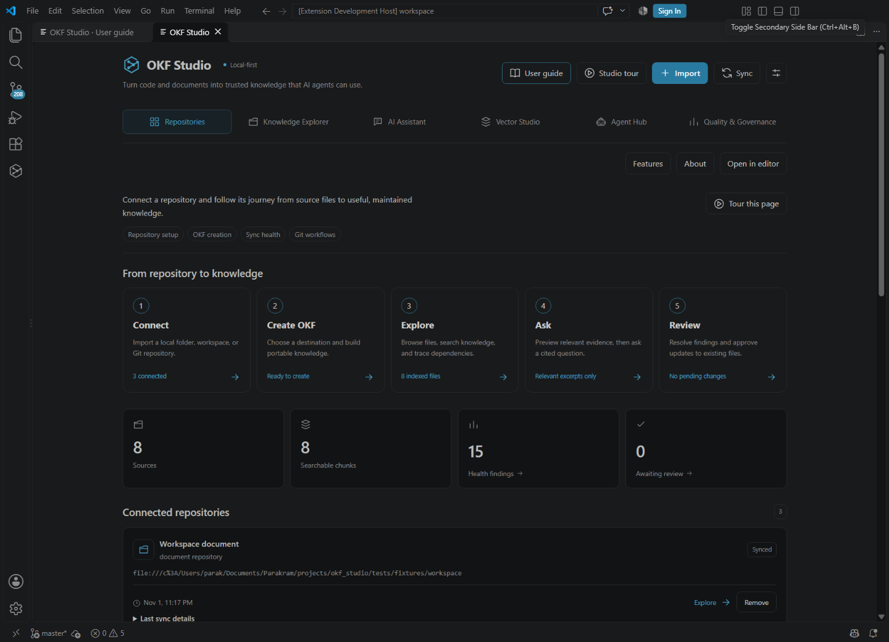
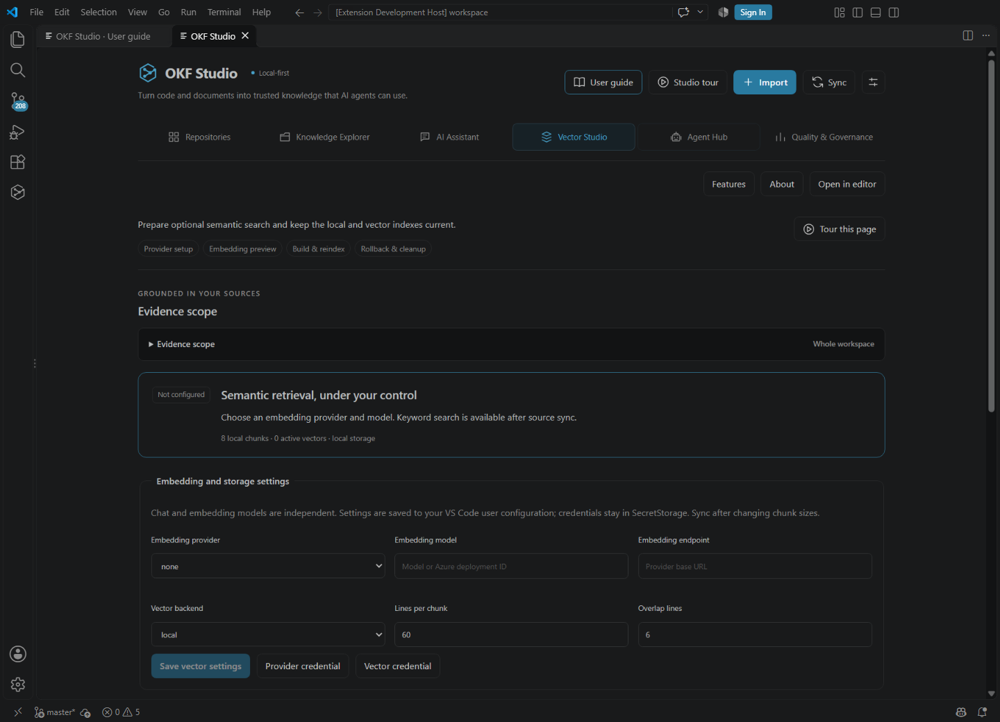
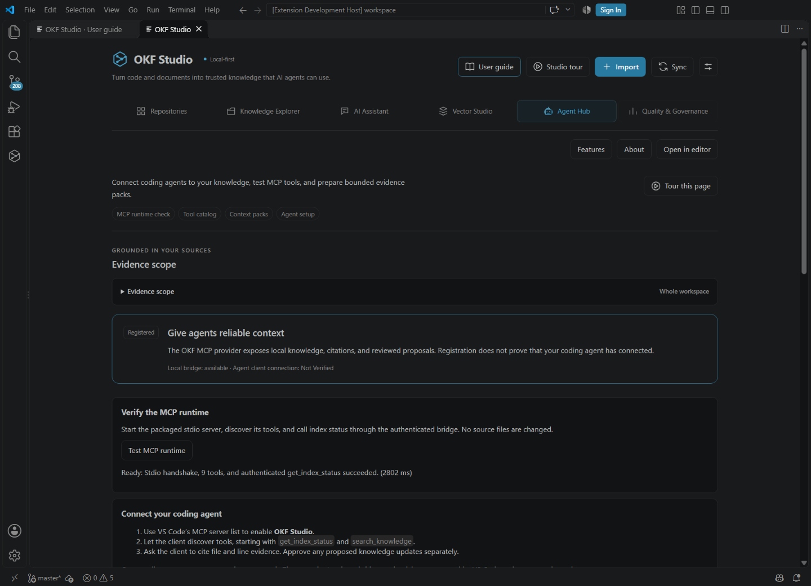

# OKF Studio


**Turn code and documents into trusted knowledge that AI agents can use.**

OKF Studio is a local-first VS Code extension for importing repositories, generating portable Open Knowledge Format (OKF) knowledge, finding cited answers, exploring code relationships and reviewing documentation changes. It supports document-only, code-only and hybrid projects, with optional models and vector services configured independently of your source knowledge.

Keyword search and evidence excerpts work offline without credentials. Generated answers and semantic embeddings require a configured model. External integrations are implemented and contract-tested; live provider, Copilot and non-Windows availability still require verification in your environment. See [current limits and planned additions](#current-limits-and-planned-additions).

Author, developer and owner: **Parakram Jain**. Source: [parakramjain/okf-studio](https://github.com/parakramjain/okf-studio) (private; collaborator access required). Marketplace publisher verification is pending.

## New in 0.4.0

Six destinations make the workflow explicit: **Repositories**, **Knowledge Explorer**, **AI Assistant**, **Vector Studio**, **Agent Hub**, and **Quality & Governance**. Use the full-width editor view, searchable Features catalog, About page and replayable tours.

- Choose a document, selected files, folder, repository, selected repositories or workspace for AI and retrieval. Ask about a source directly from its preview.
- Configure embeddings, storage and chunking in Vector Studio; test connections, inspect readiness, preview chunks and compare retrieval results.
- Test the real MCP runtime, inspect all nine tools, run read-only tools and preview/export bounded agent context packs.
- Trace requirements through observed code/test links, see sensitive-data warnings and export redacted diagnostics.

See the complete [feature catalog with status and prerequisites](docs/FEATURES.md), [user guide](docs/USER_GUIDE.md), [publishing checklist](docs/PUBLISHING.md) and [pending external requirements](docs/pendinissue.md).

## Running extension

These screenshots show the real Windows VS Code extension using non-sensitive local test sources. They do not claim live cloud/model configuration.





## Install

Build from source or install `dist/okf-studio-0.4.0.vsix`:

```powershell
code --install-extension dist/okf-studio-0.4.0.vsix
```

Requires VS Code 1.109+ on a desktop Node extension host. Remote Node hosts are supported by the architecture but have not been verified locally. Browser-only and virtual workspaces are unsupported.

1. Open a trusted workspace and run **OKF: Open OKF Studio**, or select the OKF Studio activity-bar icon.
2. Choose **Documents**, **Code** or **Both**, then import a local folder, workspace roots or an HTTPS Git repository.
3. Search immediately, or click **Proceed to Create OKF** on a repository card and choose where to create its bundle.
4. Optionally configure chat models, embeddings and vector storage with **OKF: Configure Providers and Credentials**.

The display name is OKF Studio. The internal extension ID remains `okf-studio-local.okf-knowledge-studio` for compatibility with existing installations, settings and local data.

## Features

Three flagship journeys: **Understand any repository**, **Ask your knowledge**, and **Give agents reliable context**. Supported means implemented; live service checks are separate. Experimental features use approximations. Planned features are unavailable.

### Repositories

- **Import documents, code, or both — Supported.** Connect local folders, workspace roots, and Git checkouts to one catalog; add another source type at any time. Requires: Trusted desktop workspace; Git for Git operations.
- **Create OKF where you choose — Supported.** Choose a destination, create the first bundle immediately, and review later updates to existing bundles. Requires: A synchronized source repository and writable destination.
- **Keep the catalog current — Supported.** Incrementally sync changed files, inspect sync failures, cancel work, and remove catalog entries while retaining sources. Requires: Readable imported roots.
- **Use native Git workflows — Supported.** Inspect status/history, switch branches, fetch, pull, commit, push, or clone through VS Code Git. Requires: Git and the built-in Git extension; remote credentials for network actions. Live remote actions: Not Verified.
- **PDF/DOCX and enterprise connectors — Planned.** Proposed future safe document adapters and external source connectors. Requires: Not supported in this release; import supported Markdown/text/HTML and TS/JS/Python files.

### Knowledge Explorer

- **Browse every file — Supported.** Expand real folders, open unindexed files, and select indexed files for AI without silently broadening scope. Requires: Imported readable repository; symbolic links are displayed but not followed.
- **Search and inspect evidence — Supported.** Search the full index, save views, inspect metadata and source provenance, compare two records, and export portable knowledge. Requires: Synchronized supported sources. Semantic search additionally needs a ready vector index.
- **Trace relationships and impact — Experimental.** Explore definitions, imports, calls, document links, and requirement-to-code-to-test relations with source jumps. Requires: Extracted relations. Static calls, impact, and coverage are approximate rather than runtime proof.

### AI Assistant

- **Ask one document or a chosen scope — Supported.** Ask about one file, selected files, a folder, one repository, chosen repositories, or the whole workspace. Requires: Indexed sources; a configured chat provider for synthesized answers. Evidence mode works offline.
- **Preview relevant context — Supported.** Inspect bounded excerpts, citations, and estimated input tokens before contacting a model; no relevant match means no model call. Requires: A specific lexical query, or selected files for a general summary. Synonym retrieval may need rephrasing.
- **Choose independent chat models — Supported.** Use VS Code chat models, Ollama, OpenAI, Azure, or compatible endpoints for cited answers, summaries, comparisons, and drafts. Requires: An available provider/model, credentials where required, and consent. Live provider/client accounts: Not Verified.

### Vector Studio

- **Configure and test embeddings — Supported.** Set the embedding provider/model, chunk size and overlap, and run a synthetic connection test without repository content. Requires: Available embedding service/model. Configuration does not establish a successful connection.
- **Choose vector storage — Supported.** Use local vectors, Qdrant, or PostgreSQL/pgvector and test access without changing remote collections or tables. Requires: Remote services require credentials, consent, and deployment configuration. Live remote deployments: Not Verified.
- **Build and evaluate retrieval — Supported.** Preview chunks/tokens, build or rebuild, inspect readiness, roll back, clean old namespaces, and compare retrieval scores and latency. Requires: Indexed chunks, configured embeddings, and compatible storage. Scores do not measure model groundedness.
- **Shared indexes, RBAC, and managed plans — Planned.** Proposed future team sharing, access control, managed indexing, and Pro/Team licensing. Requires: Backend, security, and commercial design work; no paid or shared service is implemented.

### Agent Hub

- **Connect agents through MCP — Supported.** Discover nine knowledge tools, inspect permissions, and test the packaged stdio runtime and authenticated status call. Requires: Trusted VS Code host with MCP API support. Each consuming client still needs its own setup and verification.
- **Prepare portable context — Supported.** Preview and export redacted evidence packs with line citations and a token budget without a model request. Requires: Relevant indexed evidence and a valid scope.
- **Install an optional knowledge agent — Supported.** Add a reviewed agent definition and try read-only tools locally before asking a coding agent to use them. Requires: Writable repository and separate human approval; existing agent files are preserved.

### Quality & Governance

- **Find knowledge risks — Experimental.** Inspect validation, drift, freshness, heuristic coverage, prompt-injection indicators, and sensitive-content warnings. Requires: Indexed sources. These heuristics are not comprehensive security or semantic validation.
- **Review changes safely — Supported.** Select all pending changes, inspect a combined diff, approve once, reject proposals, or undo unchanged approved files. Requires: Write permission and unchanged source/target hashes. A failed multi-file write can leave reported partial completion.
- **Export diagnostics and manage local data — Supported.** Export redacted diagnostics, review retention, revoke consent, and delete derived indexes without deleting source repositories. Requires: Trusted workspace; destructive local-data actions require confirmation.
- **PR-based team review — Planned.** Proposed future review through pull requests, with team governance and audit integration. Requires: Future authenticated Git hosting integration; no PR workflow is implemented.

## Detailed capabilities and earlier releases

### New in 0.3.0: a clearer workspace workflow

- Real, expandable filesystem tree with every file, lazy folders, keyboard navigation, and indexed-file selection.
- Relevant-only AI Assistant context: local ranking, compact excerpts, deduplication, no arbitrary workspace fallback, and a preview with token estimates.
- Select all pending proposals and review a combined diff with one approval action, preserving live source and target checks.
- Repositories workflow, explicit feature labels, explanations on every page, and replayable page and extension tours.
- Searchable offline [HTML user guide](docs/USER_GUIDE.html), accessible from the top toolbar and Command Palette.
- Visible Git status, history, branch, fetch, pull, commit, push, and clone actions through native VS Code Git.

### Create OKF where you choose

Each source repository has a **Proceed to Create OKF** button. Choose a parent folder and bundle folder name. A new destination is built immediately with `index.md` and `concepts/…`, then indexed and opened; initial files do not enter the Quality & Governance approval queue. Reuse that destination to queue only changed files for review. Unchanged bundles are left alone, and unrelated existing folders are preserved. The command palette action asks which repository to use when more than one is available.

### New in 0.2.0

- Refreshed dashboard, onboarding, icon navigation, source rows, empty states and review cards, with responsive sidebar layouts and VS Code theme colors.
- Save up to 12 named views containing a query, repository/folder scope, selected files and source filters. Restore them locally without automatically sending a model request; unavailable saved sources never silently broaden the scope.
- Filter sources by file path/title and type, sort by path/title/recent indexing, and browse 50 sources per page. Graphs follow the visible source filters and explicit selections.
- See per-root sync timestamps, changed/removed/skipped counts and errors on repository cards. Finding totals reflect the full catalog even when the detail list is capped.
- Filter findings by severity and text, filter the review queue by status, and start common AI tasks from prompt suggestions.
- Keep search results separate from answer citations. Citations list only evidence included in the actual context budget, and outdated search responses are discarded after scope changes.
- Reliability fixes for nested Git ignores, unchanged-file commit provenance, partial re-chunk retries, approval-time edits and vector persistence failures.

Saved views and navigation preferences use local VS Code webview state; source bodies and AI answers are excluded. Clear these in **Quality & Governance → Local data controls → Clear saved views & preferences**.

### Repository import and synchronization

| Mode      | Sources and workflows                                                                                                          |
| --------- | ------------------------------------------------------------------------------------------------------------------------------ |
| Documents | Markdown, plain text and HTML; knowledge search, documentation review and AI assistance without requiring a code repository.   |
| Code      | Python, TypeScript and JavaScript; symbol extraction, dependencies, code-to-OKF generation and associated generated knowledge. |
| Both      | Documents and code together; connect requirements, decisions, implementation and tests in one catalog.                         |

- Import local folders, all open workspace roots or an HTTPS Git clone into a new folder.
- Manage multiple repositories and roots; remove catalog entries while preserving source files.
- Synchronize filesystem changes through manual Sync and debounced file watchers. Existing Git repositories use their current local checkout; fetch/pull stays in your normal Git workflow.
- Use content hashes to skip unchanged parsing, reuse unchanged chunks/vectors and remove deleted source projections.
- Apply Git ignore rules and configurable exclusion patterns, file-size limits, binary detection, credential-file exclusions and symlink/path safety checks.
- Show indexing progress, cancellation and file-level errors; preserve completed checkpoints for a later Sync to resume.
- Import source as data without executing repository code, Git hooks or recursive submodules.

### Document and code understanding

- Extract document titles, headings, sections, links, frontmatter and source-line provenance.
- Parse TypeScript/JavaScript with the TypeScript AST and Python structure with a language-aware syntax tree.
- Extract classes, functions, methods, imports, API routes/decorators, schemas, test symbols and requirement identifiers where supported.
- Preserve repository/root identity, source URIs, content hashes, line spans, confidence and available Git commit references.
- Keep extracted facts separate from inferred business intent; label approximate static relationships.

### Portable OKF knowledge

- Parse, serialize and validate Google OKF v0.2 Markdown/YAML bundles, including reserved index/log files.
- Preserve unknown frontmatter keys, YAML comments, unknown concept types and original document bodies when editing metadata.
- Generate knowledge from code and documents using deterministic observed facts, source hashes, spans and provenance.
- Record generation identity, lifecycle metadata, verification/trust information and freshness when present.
- Navigate concept relationships and backlinks; report broken links without treating them as invalid OKF concepts.
- Create `concepts/…` documents and `index.md` directly in a new, user-selected bundle folder. Review changed files when updating an existing bundle.
- Keep knowledge as ordinary files that can be versioned in Git, independently of any LLM or vector database.
- Read attested-computation metadata without executing its referenced code or attesters.

### Search and vector indexing

- **Keyword search:** offline BM25 retrieval without an API key or model runtime.
- **Semantic search:** similarity search using actual vectors from a configured embedding model.
- **Hybrid search:** combine lexical/vector ranking with confidence-weighted graph-neighbor relevance.
- Filter retrieval by one document, selected documents, folder, repository or multiple repositories.
- Return ranked scores, excerpts and file/line citations with bounded result counts and context budgets.
- Preview heading/symbol-aware chunks, configurable size/overlap and estimated input tokens before indexing.
- Configure embedding provider, model and endpoint separately from chat.
- Store vectors locally or use Qdrant/pgvector adapters; isolate index generations by repository set, provider/model and dimension.
- Validate vector counts, dimensions and values; reuse unchanged embeddings, build incremental generations or force a full reindex.
- Stage builds before committing, preserve the previous index after failure/cancellation and roll back matching vectors without replacing current source chunks.
- Review and delete tracked historical remote namespaces through an explicit cleanup workflow.

### Scoped AI assistance

- Ask about an individual file, selected files, a folder, one repository or several repositories.
- Choose **answer**, **summarize**, **compare**, **explain**, **FAQ**, **requirements**, **ADR** or **tests** tasks.
- Use offline **evidence mode** for retrieved excerpts without model-generated conclusions.
- Select available VS Code language models, including Copilot-backed models when exposed by the editor, or configure Ollama, OpenAI, Azure OpenAI and compatible chat endpoints.
- Ground requests in bounded source evidence and provide clickable citation previews; instruct models to label inference and uncertainty.
- Stream responses with cancellation, redact common secrets/PII and report usage when supplied by the provider.
- Estimate input tokens and show unknown pricing explicitly; no model is downloaded automatically.
- Treat generated answers and drafts as advisory. Models cannot approve proposals or write source files.

### Knowledge graph and traceability

- Explore repository, file/document, module, class, function, API, schema, test, requirement and decision nodes.
- Inspect `defines`, `calls`, `imports`, `implements`, `tests`, `depends_on` and `references` relationships.
- Distinguish resolved edges from approximate static relations in an interactive, keyboard-operable graph and its text equivalent.
- Follow dependency and caller/callee relations; inspect bounded change impact through cyclic graphs.
- Trace requirement identifiers into code and test relations; surface static coverage and untested/orphaned knowledge findings.
- Detect source-hash, commit and extracted API/symbol-signature drift to guide documentation review.

Static graphs and coverage are evidence aids, not proof of runtime behavior or business correctness.

### Documentation editing and human review

- Open sources in the native Markdown/code editor with breadcrumbs, outline navigation and source previews.
- Inspect and propose YAML frontmatter edits while preserving document bodies and unknown fields.
- Follow backlinks and graph relations; compare two selected documents with VS Code's native diff viewer.
- Create ADR, Requirement and Glossary templates as pending proposals.
- Track lifecycle, owner, verification and freshness through editable frontmatter.
- Detect exact duplicates, broken links and potentially opposing must/shall statements for human interpretation.
- Review exact before/after diffs, approve or reject proposals individually or select several for review.
- Block approvals when the target or generation sources changed after preview; undo approved changes when the target still matches.
- Export a portable OKF bundle, original documents or escaped static HTML into a new destination folder.

### MCP, Copilot and custom agents

The bundled MCP server is registered automatically in trusted workspaces through the supported VS Code MCP API. Enable **OKF Studio** in the editor's MCP controls. Existing coding agents can use these tools:

| Tool                         | Capability                                                                          |
| ---------------------------- | ----------------------------------------------------------------------------------- |
| `search_knowledge`           | Find cited evidence and discover document IDs.                                      |
| `get_document`               | Retrieve a bounded, redacted document excerpt with source lines.                    |
| `get_code_context`           | Retrieve coding-task evidence and extracted symbols.                                |
| `get_dependencies`           | Inspect incoming/outgoing dependencies and their resolution status.                 |
| `analyze_change_impact`      | Traverse bounded change impact across the knowledge graph.                          |
| `trace_requirement`          | Follow a requirement into associated code/test relations.                           |
| `validate_against_knowledge` | Retrieve relevant evidence and diagnostics for human consistency review.            |
| `propose_knowledge_update`   | Ask permission to queue an update; source approval remains a separate human action. |
| `get_index_status`           | Inspect repositories, index capabilities, counts and job state.                     |

- Expose the `okf://catalog` resource and a reusable `knowledge-triage` prompt.
- Validate tool inputs with schemas, annotate read-only tools and bound returned context.
- Connect stdio agents through an authenticated local bridge to current trusted workspace state.
- Offer an optional additive Knowledge Triage `.agent.md` file after diff approval, preserving an existing agent at that path.
- Integrate with existing custom agents without overwriting their configuration.

### VS Code interface

| View     | Main actions                                                                                                          |
| -------- | --------------------------------------------------------------------------------------------------------------------- |
| Repositories | Choose repository mode, import/manage sources, inspect counts, synchronize and create OKF in a chosen location.       |
| Knowledge Explorer | Scope searches, switch list/tree/graph views, select documents, open citations, inspect metadata and compare sources. |
| AI Assistant   | Choose a task and scope, ask questions, read streamed answers/evidence and navigate citations.                        |
| Vector Studio  | Configure providers, preview chunks/tokens, build/reindex, roll back and clean historical remote snapshots.           |
| Quality & Governance | Inspect diagnostics, quality/static coverage, review proposals, create templates, export and manage local deletion.   |

The sidebar uses VS Code theme colors, responsive layouts, keyboard controls, focus indicators, screen-reader labels and live loading/error/progress states. Commands are also available through the command palette and relevant file context menus.

### Privacy, governance and operations

- Keep source records and derived indexes in workspace-isolated local SQLite storage by default.
- Require Workspace Trust and repository permission checks for indexing, models, MCP and source changes.
- Store provider credentials in VS Code SecretStorage rather than settings, webviews or logs.
- Require destination/operation-specific consent before model/vector transmission; offer one-time/session grants and consent revocation.
- Redact common credential/email patterns before egress and buffer output redaction across streaming chunks. Filtering does not identify every confidential fact.
- Delimit retrieved content as untrusted evidence; prevent model access to source-write approval.
- Use a restrictive webview CSP and render source/model content as text.
- Apply path/symlink guards, certificate-checked remote transport, redirect rejection and private/metadata-address protection; explicitly configured loopback Ollama is the local exception.
- Maintain audit events, privacy-conscious structured logs, diagnostics and trace identifiers; use bounded worker processing and HTTP retry/backoff/timeouts.
- Preserve transactional index snapshots and recoverable SQLite backups; apply configurable completed-review/audit/snapshot retention.
- Delete local derived records, proposals, vectors, audit history, recovery backup and credentials through a confirmed workflow. Source documents remain under user control; remote provider backups require separate administration.
- Keep telemetry off; this release has no telemetry exporter.

## Configuration at a glance

| Area               | Options                                                                              |
| ------------------ | ------------------------------------------------------------------------------------ |
| Chat               | Offline evidence, VS Code LM, Ollama, OpenAI, Azure OpenAI, compatible endpoints.    |
| Embeddings         | Disabled by default; Ollama, OpenAI, Azure OpenAI or compatible embedding endpoints. |
| Vector storage     | Local SQLite projection, HTTPS Qdrant or TLS PostgreSQL/pgvector.                    |
| Parsing/indexing   | File-size cap, exclusions, chunk size and overlap.                                   |
| Context/governance | Token budget, retention and explicit consent controls.                               |

Run **OKF: Configure Providers and Credentials**. Chat/embedding models and endpoints are independent. Ollama requires a running service and models already installed by you. Cloud endpoints need valid credentials and model access; pgvector also needs the required database extension/table privileges. See the [user guide](docs/USER_GUIDE.md) for setup.

## Current limits and planned additions

The feature catalog above describes implemented capabilities; remote adapters have contract tests, not a guarantee of account-specific service availability. Windows desktop activation, repository modes and UI/MCP paths have been exercised locally. Signed-in Copilot use, live external model/vector services, remote Git cloning and macOS/Linux/remote/WSL still need environment-specific checks.

Planned or optional capabilities **not included in this release**:

- PDF/DOCX ingestion adapters.
- Optional LLM enrichment of deterministic OKF proposals.
- Enterprise collaboration, identity/RBAC, policy packs and external content connectors such as GitHub/Confluence.
- Private enterprise model/vector endpoints and a telemetry exporter.

This release uses static heuristics for some Python calls, relationship resolution, coverage and contradictory statements. Large sidebar/graph/MCP results are capped; the local SQLite/graph projections use memory. Remote Git pulls, computation/attester execution and autonomous source writes are outside the current workflow. See [implementation status](IMPLEMENTATION_STATUS.md) for exact verification and remaining limitations.

## Development

```powershell
npm ci
npm run typecheck
npm run lint
npm run build
npm test
npm run test:ui
npm run test:host
npm audit
npm run benchmark
npm run package
```

UI tests use installed Microsoft Edge (`npx playwright install msedge` if needed). Host tests use installed Windows VS Code or download the supported test build on other platforms. Press F5 for an Extension Development Host. Nothing in CI publishes to the Marketplace.

The project includes unit/integration tests, real SDK stdio MCP contracts, browser UI/axe accessibility checks, isolated VS Code host tests, dependency auditing, an SBOM, VSIX inspection/checksums and a Windows/macOS/Linux CI matrix. Synthetic 1k/10k/100k benchmarks measure parsing, chunking, graph construction and retrieval; their report explicitly excludes filesystem, SQLite persistence, worker IPC and model/network time.

See [user guide](docs/USER_GUIDE.md), [developer guide](docs/DEVELOPER_GUIDE.md), [troubleshooting](docs/TROUBLESHOOTING.md), [privacy](PRIVACY.md), [implementation evidence](IMPLEMENTATION_STATUS.md) and [release notes](RELEASE_NOTES.md). Provider contract tests are distinct from live cloud verification; see status for current limits.

The format implementation follows [Google OKF v0.2](https://github.com/GoogleCloudPlatform/knowledge-catalog/blob/main/okf/SPEC.md). Integration uses [VS Code MCP](https://code.visualstudio.com/api/extension-guides/ai/mcp) and the [Language Model API](https://code.visualstudio.com/api/extension-guides/ai/language-model).

## Five-minute demo

Import `tests/fixtures/workspace` in Both mode. Explore `guide.md` and choose Ask this document. Preview a question about authentication, then use offline evidence mode to check its citations. In Vector Studio test local storage and run keyword retrieval. In Agent Hub test the runtime, preview a context pack for token verification, and inspect the read-only tools. In Quality & Governance trace REQ-001 and inspect findings. Create an OKF bundle at a new location, then regenerate after a source edit to review the changed-file diff.

For help see [troubleshooting](docs/TROUBLESHOOTING.md), [privacy](PRIVACY.md) and [security](docs/SECURITY.md). The private issue tracker requires collaborator access.
