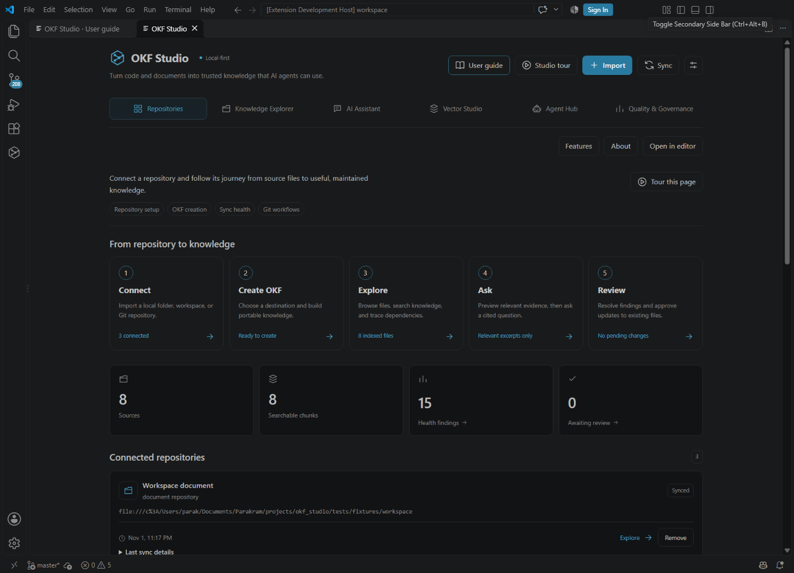
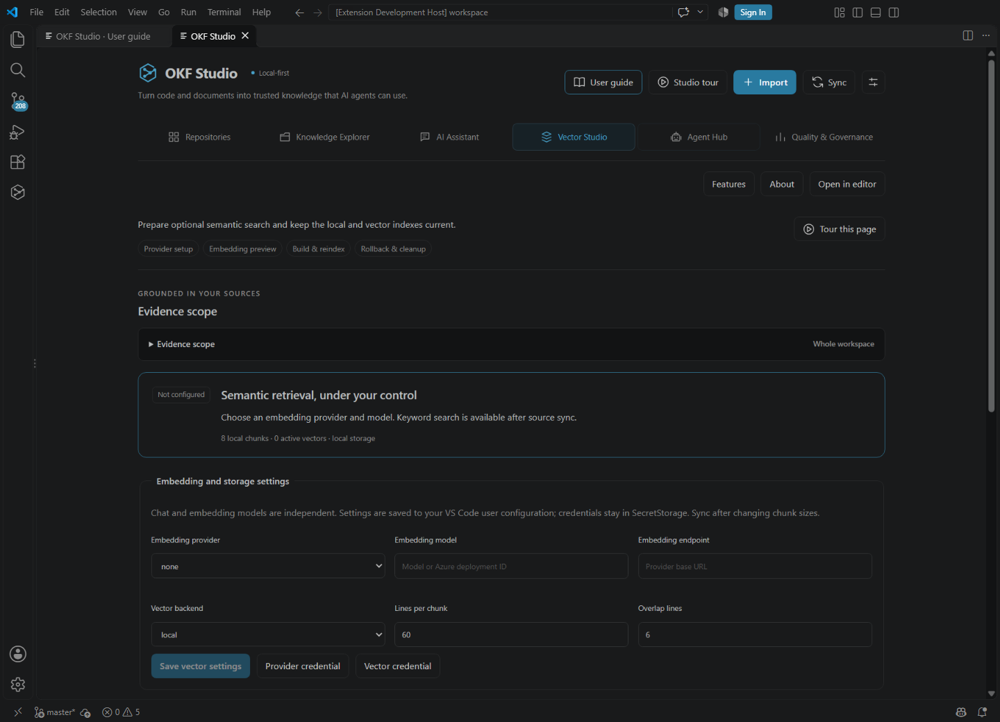
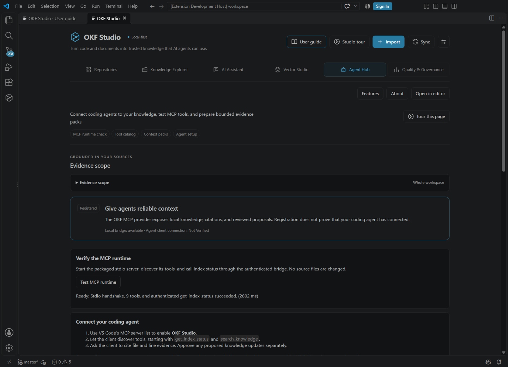

# OKF Studio user guide

**Turn code and documents into trusted knowledge that AI agents can use.**

Version 0.4.1. Author, developer and owner: Parakram Jain.

## Start here

Install the supplied VSIX with Extensions > Install from VSIX or `code --install-extension dist/okf-studio-0.4.1.vsix`. Open a trusted workspace in VS Code 1.109 or newer. Use the OKF Studio activity icon or `OKF: Open OKF Studio`. Select **Open in editor** for a wider workspace.

The top toolbar includes **User guide**, **Studio tour**, **Features**, and **About**. Every section has a purpose, explicit features and **Tour this page**. The guide works offline and its search stays on your device.

Three ways to get value: understand a repository, ask cited questions, or give a coding agent reliable context. Models are optional. Keyword search, source browsing, deterministic OKF generation and evidence answers work locally.

## Repositories

Choose **Documents**, **Code**, or **Both**, then **Choose source**. Import a local folder, current workspace roots or an HTTPS Git repository. Document mode indexes Markdown, text and HTML. Code mode indexes TypeScript, JavaScript and Python. Hybrid mode combines both. You can add more repositories later; the modes share one local catalog.

The workflow is Connect > Create OKF > Explore > Ask > Review. Cards show source counts, sync health and per-root errors. **Sync** refreshes the local catalog from current files. It does not fetch or pull Git changes. Incremental hashing skips unchanged parsing, removes deleted files, and resumes safely after cancellation. Watchers refresh external edits.

Indexing honors ignore rules, permissions and size limits (1 MiB per file by default). It skips binary files, symlinks and credential directories. Imported code is never executed. PDF/DOCX and external content connectors are planned, not available.

## Create your OKF

1. Import a repository and finish synchronization.
2. Choose **Proceed to Create OKF** on its repository card.
3. Pick the parent location and enter the new bundle folder name.
4. A new destination is created immediately with `index.md` and `concepts/` documents, registered as a document repository, and opened.

First creation does not queue every file for approval. Reusing an existing bundle queues only changed files in **Quality & Governance**. Identical output is skipped. Existing unrelated destinations are preserved; cancellation does not publish a partial bundle.

Generated concepts record observed facts, file and line provenance, source hashes and available Git commits. They are ordinary Markdown/YAML files you can version in Git. Extracted facts do not establish inferred business intent.

## Knowledge Explorer

**Tree** expands actual folders, including hidden, unsupported and unindexed files. Large folders provide **Load more**. Symlinks are listed without being followed. Open files in the editor; only indexed files have evidence-selection checkboxes. Arrow keys navigate the tree. **Refresh tree** refreshes its filesystem view.

**List** shows indexed sources with name/type/sort filters and pages of 50. **Graph** shows observed and approximate relationships, a keyboard-accessible text equivalent, source links and bounded change impact. Choose two indexed documents to compare them. Source previews show content, outline, metadata and provenance; **Ask this document** opens AI Assistant with that document selected.

**Evidence scope** supports a single document, selected documents, a folder prefix, one repository, selected multiple repositories, or the workspace. With multiple repositories enabled, selecting none produces no evidence. Folder and file constraints intersect repository selection. Source-list display filters do not silently change retrieval scope.

Save up to 12 named views of scope, search and display preferences. Restoration does not call a model. A missing referenced repository/document prevents restoration instead of widening access. Saved navigation from older releases migrates to the six-section layout. Questions, answers and source bodies are not stored in webview preferences.

For large catalogs the UI discloses caps: 2,000 source records, 1,500 graph nodes/4,000 edges in the payload, 200 rendered graph nodes, and 500 findings. Search still checks the full local catalog. The document picker uses the loaded catalog; use the full tree for other indexed files.

## AI Assistant

Choose a scope, enter a concrete **Question**, then **Preview context** or **Ask in scope**. A selected document can be sent to AI Assistant from its source preview in one action. The native Explorer/editor command **OKF: Ask About Selected Files** also scopes the assistant.

Workspace questions first rank evidence locally. The default is at most six relevant excerpts, at most two per file, and 3,000 estimated input tokens including instructions and the question. The complete generated bundle is not sent for each question. No relevant match means no model request. Generic summaries require explicit file selection.

Preview shows the bounded evidence pack and token estimate without contacting a chat model. Open each file/line citation to verify an answer. **Choose model** opens the native chat-provider/model selection. Evidence mode returns local excerpts without claiming to generate an answer. Other choices include VS Code models, Ollama, OpenAI, Azure and a compatible endpoint. Availability and access depend on your configuration.

Chat and embedding providers are independent. Store credentials through native credential controls in SecretStorage, never in URLs or repository files. External calls require destination consent. Approximate token counts are not provider billing; price is shown as unknown rather than invented. Cancel interrupts the active operation. Model output remains untrusted even when cited.

## Vector Studio

Configure the embedding provider, model/deployment, endpoint, vector backend, chunk size and overlap here. **Save vector settings** writes VS Code user settings. Credentials use native SecretStorage prompts. Synchronize sources after chunk-policy changes, then rebuild vectors. Ollama must already be running with a suitable model; the extension does not download models.

**Test embedding connection** sends only a fixed synthetic sample and validates the returned vector. **Test vector connection** checks local storage, Qdrant collections or the installed pgvector extension without changing collections/tables. Connection success is independent of whether the current source index is ready.

| Index state | Meaning and next action |
| --- | --- |
| Not configured | Select an embedding provider/model or build the first index. Keyword retrieval remains available. |
| Indexing | A staged build is running; wait or cancel. |
| Ready | All current chunks match the active model and storage configuration. |
| Stale | Sources/settings changed; synchronize and rebuild. |
| Failed | Inspect the error, correct configuration, test and retry. The previous committed index is retained. |
| Unsupported | Select local, Qdrant or pgvector storage. |

**Preview chunks** shows source spans, excerpts, total chunks and an approximate embedding token count. Embedding jobs may process the entire indexed catalog; this is separate from the small question context. **Build vector index** reuses unchanged vectors. **Rebuild index** forces fresh embeddings. Both stage before committing; failure/cancellation preserves the last completed namespace.

**Rollback index** restores a previous vector snapshot while retaining current source chunks. Configure its matching model before querying. **Clean remote snapshots** removes selected tracked historical namespaces after native confirmation. Active remote vectors and provider backups require provider administration; deleting local data does not erase them.

Use the **Retrieval playground** with keyword, semantic or hybrid retrieval. It uses the evidence scope, shows ranked excerpts, scores, source links and measured latency. Semantic/hybrid options require a Ready index here. Retrieval scores do not prove an answer correct. Cloud providers and remote vector deployments are implemented and contract-tested but need live verification with your account.

## Agent Hub

**Registered** means VS Code knows the MCP provider. The local bridge and a signed-in client connection are separate states. **Test MCP runtime** launches the bundled stdio server, discovers tools, and calls `get_index_status` through the authenticated bridge. A successful test does not claim that Copilot or another client has connected.

Use VS Code's MCP server list to enable **OKF Studio**, let the client discover tools and start with status/search. **Install optional knowledge agent** adds an agent definition without replacing an existing one. The tool catalog shows read-only versus proposal permissions. The playground runs only read-only tools.

Tools: `search_knowledge`, `get_document`, `get_code_context`, `get_dependencies`, `analyze_change_impact`, `trace_requirement`, `validate_against_knowledge`, `get_index_status`, and `propose_knowledge_update`. The proposal tool asks permission to queue a change; applying it requires a separate diff review and approval.

Describe a coding task and choose a token budget to **Preview context pack** or **Export context pack**. Packs contain relevant, bounded, redacted excerpts and citations without a model call. The global token budget also applies. Exported packs are ordinary JSON files; treat their source-derived content as private. Bridge credentials are session-local and never exposed in the UI.

## Quality & Governance

Review errors/warnings, broken links, source drift, provenance, coverage and possible sensitive-data patterns. **Refresh validation** synchronizes current sources before checking. Findings and relationship/contradiction coverage include static heuristics; inspect source context before acting.

Use **Select all**, **Review & approve selected**, or **Review & approve all** to inspect a combined diff and confirm once. Individual review, reject and undo remain available. Targets, permissions and source hashes are checked again after confirmation; concurrent edits block writes. A batch I/O failure reports completed and remaining changes. Undo refuses to overwrite later edits.

**Requirement to code to tests** accepts an identifier such as REQ-001 and returns observed relationships with source links. **Export diagnostics** saves redacted JSON with counts, findings and connection status. Review exports before sharing; redaction is heuristic. Document tools include templates, native editing/comparison, Markdown/JSON/HTML export and local data controls. Git-PR-based team approval is planned.

## Git workflows

The Repositories Git panel and Command Palette expose status/diff, history, branch switching, fetch, pull, commit, push and clone. Select the intended repository. Native Git may ask about changes, branch, commit message, authentication or remote synchronization. Review those prompts. Existing repositories use VS Code's Git workflow; importing HTTPS Git disables hooks and recursive submodules.

Local status/history are covered by the host acceptance check. Remote Git actions need credentials and a real remote and are not certified by those local checks. Source publication of OKF Studio is separate from testing every extension Git action.

## Help and accessibility

Use **Studio tour** for all six destinations or **Tour this page** at any time. Tours and Features/About dialogs support keyboard focus, Escape and return focus. Features can be searched and filtered by category and show Supported, Experimental or Planned status plus prerequisites. The wider editor view, theme tokens, responsive controls and text graph support different working styles. Manual screen-reader testing remains pending.

## Troubleshooting and privacy

No evidence: synchronize, check evidence scope and use concrete terms present in your sources. No vectors: select an embedding model, test both connections and build. Stale vectors: synchronize and rebuild after source/settings changes. MCP failure: trust the workspace, use a desktop Node host, run the runtime test and inspect VS Code's MCP/OKF output.

Private cloud endpoints are blocked by default; loopback Ollama is the explicit exception. PostgreSQL requires verified TLS and pgvector. Unsupported PDF/DOCX files are browseable but are not indexed.

The local SQLite database contains source-derived content and is not separately encrypted. Protect your OS account/disk. No telemetry exporter is enabled. Pattern redaction cannot catch all sensitive information. Egress grants last for the session and are revoked after configuration changes. Read the bundled PRIVACY and SECURITY documents before deploying to a shared environment.

## Command reference

Use the Command Palette with the **OKF:** prefix: Open OKF Studio, Open OKF Studio in Editor, Import Repository, Synchronize Repositories, Proceed to Create OKF, Configure Providers and Credentials, Ask About Selected Files, Install Optional Knowledge Agent, Export Knowledge, Delete Local Index and Revoke Consent, Open User Guide, and Git Status & Diff / Commit History / Switch Branch / Fetch / Pull / Commit / Push / Clone Repository.

Version 0.4.1 uses publisher `ParakramJain`, giving it extension ID `ParakramJain.okf-knowledge-studio`. Disable the old `okf-studio-local` extension and reload before enabling this version. The current workspace catalog is imported once from the old storage location when the new catalog is absent; invalid legacy data blocks migration rather than being silently discarded. Source/OKF files and old catalog files are preserved. Re-enter provider credentials; session consent starts fresh. Command IDs, `okf.*` settings and database schema remain compatible. The source repository is public at https://github.com/parakramjain/okf-studio. Installable public previews are distributed through GitHub Releases; Marketplace submission uses the configured publisher and Trusted Publishing policy.

## Product screenshots

The bundled images show the real Windows extension host with non-sensitive test sources.

